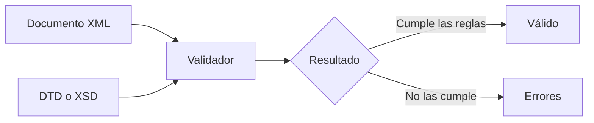

# Unidad 3. Validación de documentos XML

## ¿Qué aprenderemos?

En la unidad anterior aprendimos a crear documentos XML bien formados. Sin embargo, que un archivo no tenga errores de sintaxis no garantiza que posea la estructura que necesita una aplicación.

En esta unidad aprenderemos a definir y comprobar las reglas que debe cumplir un vocabulario XML mediante dos tecnologías:

- **DTD (Document Type Definition):** lenguaje sencillo y compacto para describir estructuras XML.
- **XML Schema o XSD:** lenguaje basado en XML que permite definir estructuras, tipos de datos y restricciones más precisas.

## Recorrido de la unidad

1. [Documentos bien formados y documentos válidos](01-bien-formado-y-valido.md)
2. [DTD: elementos y modelos de contenido](02-dtd-elementos.md)
3. [DTD: atributos, entidades y modularización](03-dtd-atributos-y-entidades.md)
4. [XML Schema: fundamentos](04-xsd-fundamentos.md)
5. [XML Schema: tipos, restricciones y reutilización](05-xsd-restricciones.md)
6. [Validación en VS Code y resolución de errores](06-validacion-y-errores.md)
7. [Resumen, autoevaluación y ejercicios](07-resumen-y-ejercicios.md)

## Objetivos de aprendizaje

Al finalizar la unidad podrás:

- Diferenciar un documento XML bien formado de uno válido.
- Asociar un XML con una DTD interna o externa.
- Declarar elementos, atributos y entidades mediante DTD.
- Interpretar secuencias, alternativas y cardinalidades.
- Crear un esquema XSD y asociarlo a un documento XML.
- Utilizar tipos de datos predefinidos de XML Schema.
- Crear tipos simples y complejos.
- Aplicar restricciones sobre valores y repeticiones.
- Interpretar los mensajes producidos por un validador.
- Elegir entre DTD y XSD según las necesidades del problema.

## Caso conductor

Los ejemplos utilizan principalmente la carta de un guachinche iniciada en la unidad anterior. Partiremos de un documento XML como este:

```xml
<?xml version="1.0" encoding="UTF-8"?>
<carta nombre="El Caldero del Teide">
  <seccion tipo="entrantes">
    <plato id="P01" vegetariano="true">
      <nombre>Papas arrugadas</nombre>
      <descripcion>Papas con mojo rojo y verde.</descripcion>
      <precio moneda="EUR">6.50</precio>
    </plato>
  </seccion>
</carta>
```

Durante la unidad definiremos reglas como:

- La raíz debe llamarse `carta`.
- Una carta debe contener una o varias secciones.
- Cada sección debe tener un tipo.
- Cada plato debe poseer un identificador único.
- El precio debe ser un número positivo.
- La moneda solo puede tomar determinados valores.

## Idea fundamental

> XML almacena los datos; DTD o XSD definen qué estructura y valores están permitidos; el validador comprueba si el documento cumple esas reglas.



## Requisitos previos

Antes de comenzar conviene recordar:

- Declaración XML.
- Elemento raíz.
- Elementos, atributos y contenido.
- Relaciones padre, hijo y hermano.
- Anidamiento y buena formación.
- Uso de VS Code y apertura de archivos XML.

## Organización recomendada del repositorio

```text
unidad-03-validacion-xml/
├── ejercicios/
│   ├── dtd/
│   └── xsd/
├── actividades/
├── img/
└── README.md
```

---

[Comenzar: documentos bien formados y válidos →](01-bien-formado-y-valido.md)
